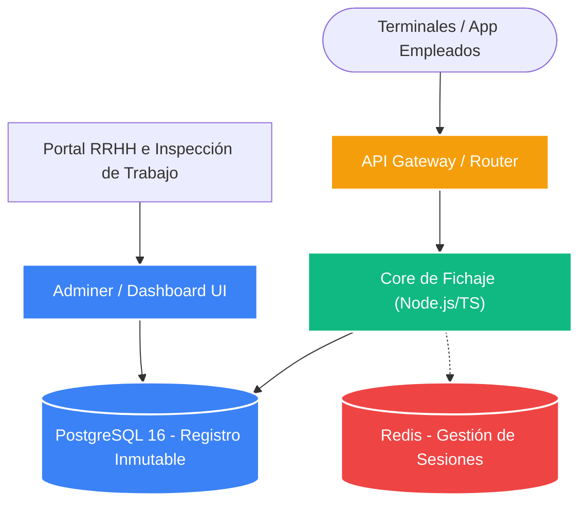

# ⏳ Proyecto Kronos - Fichaje Digital 2025

[](https://microservices.io/)
[](https://nodejs.org/)
[](https://www.postgresql.org/)
[](https://www.boe.es/)

> **Kronos es una plataforma de software de fichaje digital obligatorio 2025, diseñada para garantizar el cumplimiento normativo estricto del registro de jornada laboral. Su infraestructura distribuida está completamente contenerizada (Docker) y optimizada para alta disponibilidad, asegurando la trazabilidad inmutable de los marcajes, la gestión de turnos y la interoperabilidad con sistemas de nóminas.**

---

## 🎯 Executive Overview
La gestión del tiempo y la asistencia en grandes corporaciones requiere precisión milimétrica y seguridad inquebrantable. Kronos no solo permite a los empleados registrar sus jornadas fácilmente, sino que protege legalmente a la empresa mediante registros inmutables ante inspecciones de trabajo.

---

## 🏗️ System Architecture (Mermaid)



---

## 📚 Estructura de Componentes

```text
Kronos/
├── apps/                   # Microservicios de marcaje y control horario
│   ├── backend/            # Lógica principal del servidor de fichaje
│   └── frontend/           # Capa de presentación (Empleados y RRHH)
├── docker-compose.yml      # Definición de la topología local
├── docker-compose.prod.yml # Definición de topología de producción (Alta Disponibilidad)
├── package.json            # Gestor de dependencias del monorepo
└── README.md               # Documentación ejecutiva
```

---

## 🔐 Cumplimiento y Rendimiento
1. **Cumplimiento Normativo 2025:** Diseñado específicamente para cumplir con las regulaciones laborales de control horario (registro inmutable, retención de datos y exportación legal).
2. **Contenerización Estricta y Seguridad:** Uso de imágenes Alpine ligeras y aisladas. Redis y PostgreSQL se comunican mediante redes internas de Docker para garantizar la privacidad y seguridad de los datos de los empleados.